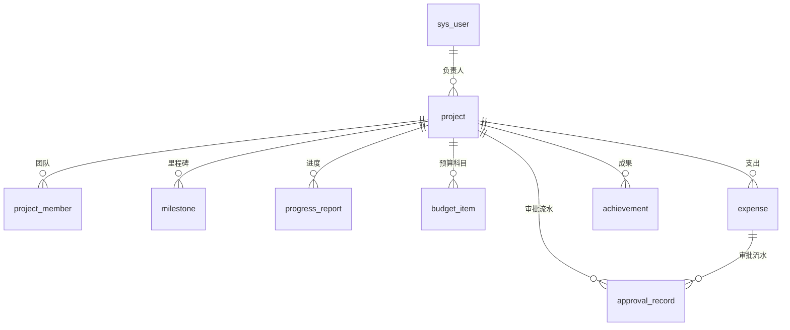

# 设计决策说明

> 这份文档回答三个问题：**我做了什么、为什么这么做、为什么不做别的**。
> 代码可以看实现，这里只写"选择"和"取舍"。

---

## 1. 我对题目的理解

题目给的背景只有一句：某科研院所要做一套科研项目全生命周期管理系统，覆盖申报、立项、进度、经费、验收到成果。

这句话里其实藏着四个约束，决定了后面所有设计：

1. **"院所"不是"公司"**——项目来源多样（国家级/省部级/院所级/横向），经费按科目管理，验收要对照任务书指标。这是科研管理的领域特征，不能套用通用项目管理工具。
2. **"全生命周期"意味着状态流转是主干**——不是一个 CRUD 列表，而是一条有审批、有回退、有留痕的链路。所以我把状态机单独抽成 `WorkflowService`，而不是散落在各个 Controller 里。
3. **"帮助打通数据、实时掌握进展"**——管理者要的是"我现在该处理什么、哪里有风险"，所以工作台必须回答"待办 + 预警"，而不是堆图表。
4. **这是面试题，不是完整产品**——评审看的是判断力和交付质量，不是功能数量。所以我优先把**一条主链路做透**，而不是铺十个半成品模块。

---

## 2. 范围决策：做什么，不做什么

### 做的（按优先级）

| 模块 | 做到什么深度 | 为什么 |
| --- | --- | --- |
| 项目申报与两级审批 | 完整状态机 + 驳回重提 + 审批留痕 | 这是"全生命周期"的主干，缺了就不是科管系统 |
| 权限体系 | 5 角色 + 接口级 + 数据级（本人/本部门/全院） | 科研系统天然多角色；数据越权比功能缺失更致命 |
| 进度管理 | 里程碑 + 定期填报（进度/问题/下期计划） | "实时掌握项目进展"的最小可信实现 |
| 经费管理 | 科目预算 + 支出申请 + 财务审批 + 额度双重校验 | 经费是科研管理最容易出事的地方，规则必须硬 |
| 成果管理 | 五类成果登记 + 结题前置校验 | 成果是验收的依据，和状态机强关联 |
| 工作台 | KPI + 状态分布 + 经费执行 + 近 6 月支出 + 风险预警 | 管理者视角的入口 |
| 审计日志 | 关键动作落库（人/动作/对象/IP/时间） | 审批类系统没有留痕就无法追责，成本又很低 |
| AI 预审 | 规则引擎打分 + 可选 LLM 意见 | 呼应岗位的 AI Native 要求，见第 8 节 |

### 不做的（以及原因）

| 不做 | 原因 |
| --- | --- |
| 工作流引擎（Flowable/Activiti） | 本项目只有一条主流程和两级审批，引入引擎会让"看懂流程"的成本远高于收益。状态机 + 审批记录表足够，且更容易写测试。若未来出现"多套申报模板、动态审批链"，再引入不迟。 |
| 附件上传/合同扫描件 | 涉及文件存储、病毒扫描、权限继承，成本高但对演示核心链路增益有限。已在 README 列为后续项。 |
| 消息通知（邮件/站内信） | 通知是"触达"问题，不是"流程"问题。MVP 用工作台待办 + 预警列表替代，等主链路稳定后再接。 |
| 专家评审打分/会议评审 | 属于评审子域，业务规则因院所而异，硬编码一个版本反而失真。 |
| 多租户 / SSO | 单院所部署，过早抽象租户维度会让所有查询都多一个条件。 |
| 前端组件库自研 | Element Plus 足够覆盖中后台场景，自研只会拖慢交付。 |

---

## 3. 角色与权限

### 角色定义

| 角色 | 代码 | 核心职责 |
| --- | --- | --- |
| 科研人员 | `RESEARCHER` | 申报、执行、报销、结题 |
| 部门管理员 | `DEPT_ADMIN` | 部门内初审（第一道关） |
| 科研处管理员 | `ADMIN` | 立项、验收、预算调整、终止、全局数据 |
| 财务 | `FINANCE` | 经费审批 |
| 院领导 | `LEADER` | 全院只读，看板与预警 |

### 权限矩阵（关键动作）

| 动作 | 科研人员 | 部门管理员 | 科研处 | 财务 | 院领导 |
| --- | --- | --- | --- | --- | --- |
| 新建/编辑草稿 | ✅ 本人 | ✅ | ✅ | ❌ | ❌ |
| 提交申报 | ✅ 负责人 | ✅ 本人项目 | ✅ | ❌ | ❌ |
| 部门审核 | ❌ | ✅ 本部门 | ✅（可代审） | ❌ | ❌ |
| 立项审批 | ❌ | ❌ | ✅ | ❌ | ❌ |
| 进度/成果/经费申请 | ✅ 项目组成员 | ✅ | ✅ | ❌ | ❌ |
| 经费审批 | ❌ | ❌ | ✅ | ✅ | ❌ |
| 结题验收/终止 | ❌ | ❌ | ✅ | ❌ | ❌ |
| 审计日志 | ❌ | ❌ | ✅ | ❌ | ❌ |

### 实现方式

- **接口级**：自定义 `@RequireRole` 注解 + `AuthInterceptor` 统一拦截，避免每个方法里写 if。
- **数据级**：`ProjectService#applyScope` 统一拼查询条件——科研人员 = 负责人 ∪ 项目组成员；部门管理员 = 本部门 ∪ 本人参与；其余角色不限制。列表、驾驶舱、经费列表共用同一套规则，防止"某个接口忘了过滤"。
- **动作级**：`requireOperate` / `requireView` / `requireEdit` 收口在 Service，任何写操作先过权限再谈业务。
- **不能自己批自己**：审批环节校验角色与部门归属，科研人员调用审批接口直接 403（冒烟测试覆盖）。

> 没有引入 Spring Security：MVP 只需要"认证 + 角色门禁"，自写拦截器约 100 行、可读可控。代价是需要自己保证路径放行正确（已在 `WebConfig` 显式列出白名单）。若后续要接 SSO/OAuth2、方法级细粒度权限，会换成 Spring Security。

---

## 4. 状态机

设计要点：

- **状态只在一处改**：`WorkflowService` 是唯一入口，`ProjectService` 只负责改数据，不碰状态。这样"谁能从哪个状态走到哪个状态"只有一份真相。
- **每次迁移必留痕**：`approval_record` 记录 `from_status / to_status / operator / opinion`，前端直接渲染成时间线，不需要额外拼装。
- **前置条件放在迁移入口**：提交时校验摘要≥30 字、有预期成果；结题时校验成果≥1、无待审批报销。校验失败给出可执行的中文提示，而不是"操作失败"。
- **驳回是可回退的**：`REJECTED` 可编辑后重新提交，符合真实场景（申报被退回改材料是常态）。

---

## 5. 数据模型

| 表 | 作用 | 关键设计 |
| --- | --- | --- |
| `sys_user` | 用户与角色 | 角色用枚举字符串而非关联表：角色固定 5 个，关联表只会增加 join |
| `project` | 项目主档 | 逻辑删除 `deleted`；冗余 `leader_name / dept` 避免列表页 join；`ai_score / ai_report` 缓存最近一次预审结果 |
| `project_member` | 团队成员 | 负责人也会写入一条，便于"我参与的项目"统一查询 |
| `milestone` | 里程碑 | 状态存 `PENDING/DONE`；**逾期不落库**，由 `plan_date < today` 实时判定，避免定时任务 |
| `progress_report` | 进度填报 | 保留历史，最新一条即当前进度；不去覆盖旧值，保证可追溯 |
| `budget_item` | 科目预算 | 按 5 个固定科目存金额，合计必须等于 `project.budget_total`（保存时校验） |
| `expense` | 支出单据 | 状态 `PENDING/APPROVED/REJECTED`；同时存审批人与意见，便于列表直接展示 |
| `achievement` | 成果 | 类型枚举；结题时按项目计数 |
| `approval_record` | 审批流水 | `biz_type + biz_id` 支持项目与经费两种单据共用一张表 |
| `audit_log` | 操作审计 | 与审批流水的区别：审计记录**所有**关键动作（含创建、修改、登录），审批流水只记录状态迁移 |

**为什么金额用 `DECIMAL(14,2)` 而不是 double**：经费要精确到分，浮点累加会出现 0.01 的误差，评审看到这种细节会扣分。

**为什么预算校验要算上"审批中"**：只算已通过，会出现 10 笔待审批把额度全部占满的情况。`checkBudget` 的口径是"已通过 + 在途"，审批时排除当前单据自身，避免自己卡自己（这个 bug 在冒烟测试里被抓到并修掉）。

---

## 6. 关键业务规则

| 规则 | 位置 | 说明 |
| --- | --- | --- |
| 预算科目合计 = 预算总额 | `ProjectService#replaceBudgets` | 差 0.01 元都报错，提示具体差额 |
| 支出申请额度校验 | `FinanceService#checkBudget` | 分科目：已通过 + 审批中 + 本次 ≤ 科目预算 |
| 审批时二次校验 | `FinanceService#approveExpense` | 防止"申请时没超、审批时已被别的单据占满" |
| 结题前置条件 | `WorkflowService#submitAcceptance` | 至少 1 项成果 + 无待审批单据 |
| 驳回必填意见 | `WorkflowService#review` | 无意见的驳回对申请人没有信息量 |
| 部门管理员限本部门 | `WorkflowService#review` | 跨部门审核直接 403 |
| 项目编号生成 | `ProjectService#nextCode` | `PRJ-{年}-{三位序号}`，插入前查重循环 |

**事务**：涉及多表写入（项目 + 成员 + 预算）的方法统一 `@Transactional`，避免出现"项目建了、预算没写进去"的半成品数据。

---

## 7. 技术选型与理由

| 选择 | 备选 | 为什么 |
| --- | --- | --- |
| Spring Boot 3.2 + Java 17 | Spring Cloud 微服务 | 单体足够支撑 MVP；拆微服务会让评审多装 N 个中间件，与"可运行"目标冲突。分层已按模块切好（controller/service/mapper），未来可按项目域拆分。 |
| MyBatis-Plus | JPA | 列表页大量条件拼接 + 分页，MP 的 `LambdaQueryWrapper` 更直观；团队（RuoYi 系）也更熟悉。代价是复杂 SQL 要手写，本项目暂无。 |
| H2 文件库（默认） | MySQL / Docker Compose | "评审能一条命令跑起来"优先级最高。H2 是文件持久化，满足"不能只用内存"的加分项；同时保留 MySQL profile，切库只改配置。 |
| JWT + 自写拦截器 | Spring Security | 见第 3 节。 |
| Vue 3 + Element Plus | Vue 2 + Element UI | 岗位要求 Vue3 优先；组合式 API 在详情页这种多状态页面里更好组织。 |
| ECharts | 其他图表库 | 中后台图表覆盖全，按需引入成本低。 |
| 单 jar 内嵌前端 | Nginx 分离部署 | 交付时"一个 jar 就能演示"，减少环境变量。开发时仍用 Vite 热更新，两种模式都保留。 |

---

## 8. AI 的使用方式（AI Native 的诚实回答）

### 8.1 产品里的 AI：申报预审

- **规则引擎打底**：摘要长度、预期成果、预算结构（劳务>60%、设备>70%）、周期（>48 月或<6 月）、团队规模、名称规范。输出 0-100 分 + 分级风险项 + 建议。
- **LLM 只负责"说人话"**：配置 API Key 后，把项目结构化信息送给大模型生成 200 字评审意见；**评分仍由规则给出**。原因：分数要可复现、可解释，面试官/评审换个时间点跑不应该得到不同结果。响应里 `engine` 字段如实标注来源，LLM 调用失败自动降级为 `RULE`，不让功能挂掉。
- **为什么不做"AI 自动填表"**：申报书的核心是研究者的判断，自动生成只会产出正确但空洞的文本，对评审没有价值，反而增加伦理与合规风险。

### 8.2 开发过程中的 AI：怎么用、怎么把关

这道题本身考察"AI 工具驾驭能力"，我的实际做法：

1. **先定契约再让 AI 写**：先手写 DTO/枚举/状态机规则，再让 AI 补 Controller/Service 的样板代码。AI 擅长的是"结构确定的重复劳动"，不擅长"业务判断"。
2. **AI 生成必须可验证**：每轮生成后跑 `mvn package` + 冒烟测试。这次实际抓到两个问题——预算校验把当前单据算进去导致审批必然失败；`ProjectListItem` 缺 `leaderId` 导致前端无法判断编辑权限。两个都不是编译错误，只有跑流程才会暴露。
3. **不让 AI 决定"做什么"**：范围取舍（第 2 节）是我自己定的，AI 倾向于"把功能铺满"，那会让 MVP 失去焦点。
4. **可读性优先于生成速度**：AI 写的代码我会按项目风格重排（统一 `Result`、统一异常、统一命名），否则代码会像五个人写的。

---

## 9. 工程质量上的几个刻意选择

- **统一响应与异常**：`Result{code,message,data}` + `@RestControllerAdvice`，前端只处理一种结构；业务异常带明确中文提示，直接可展示给用户。
- **字典单一来源**：后端 `Dicts` 枚举同时提供校验与中文标签，接口返回 `statusLabel/categoryLabel`，前端不再散落 if-else 翻译。
- **列表页避免 N+1**：项目列表的"已支出""最新进度"用一次 `IN` 查询后在内存分组，而不是每行查一次库。
- **审计与审批分离**：`audit_log` 记录所有关键动作，`approval_record` 只记录状态迁移，职责不混。
- **演示数据即测试夹具**：`DataInitializer` 造了 8 个项目，覆盖草稿/待审/待立项/执行中/待验收/已结题/已驳回/逾期/超预算 9 种场景，打开工作台就能看到预警，不需要手动造数据。
- **可执行验证**：`scripts/smoke-test.mjs` 用 Node 内置 fetch 跑完整链路 + 越权断言（27 项），评审可自行复跑。

---

## 10. 已知问题与后续演进

**当前明确没做好的地方**

1. **预算校验存在并发窗口**：`checkBudget` 是"先查后写"，两个请求同时通过校验仍可能超额。生产应加 `expense` 侧的唯一约束/乐观锁，或在 MySQL 用 `SELECT ... FOR UPDATE` 锁预算行。MVP 未做，但已在代码注释中标注。
2. **驾驶舱全量内存聚合**：当前按用户可见范围把项目/支出全查出来再算。单院所（几百个项目）没问题，数据量上万时需要改成 SQL 聚合 + 物化视图。
3. **附件缺失**：任务书、发票、结题报告无法上传，真实业务必需。
4. **无通知**：审批到下一步没有提醒，只能靠用户主动看工作台。
5. **审计日志未做归档/分级保留**，长期会膨胀。
6. **前端包体积**：ECharts 全量引入导致首屏 chunk 偏大（构建时有告警），生产应按需引入。

**如果继续做，下一步优先级**

1. 附件上传 + 结题材料打包（真实业务刚需）
2. 经费报销与财务系统对接（导出凭证、对账）
3. 消息通知（站内信 + 邮件），把"待办"推到人
4. 项目模板与申报书导出（Word/PDF），减少科研人员重复劳动
5. 数据权限细化到"项目密级"，支持涉密项目隔离

---

## 11. 如何快速验证这份交付

1. `java -jar backend/target/rims-backend.jar` → 打开 <http://localhost:8080>
2. 用 `zhangsan` 登录，打开任一执行中项目 → 点「AI 预审」，看评分与风险项
3. 切 `admin` → 审批中心 → 对一条待立项项目点「立项」，再去项目详情看审批时间线
4. 切 `zhouying` → 经费管理 → 通过一笔待审批支出；再回项目详情看预算执行率变化
5. `node scripts/smoke-test.mjs` → 期望 27 项全通过（含 4 项越权拦截）
6. 重启服务 → 数据仍在（H2 文件持久化）
