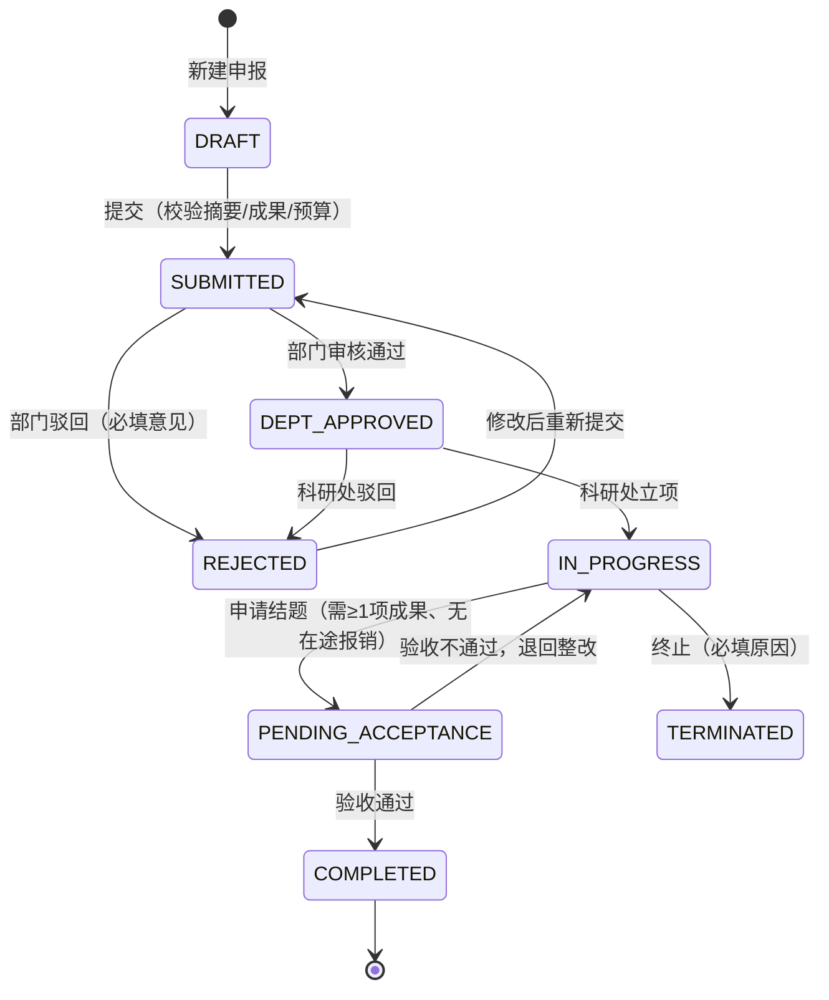
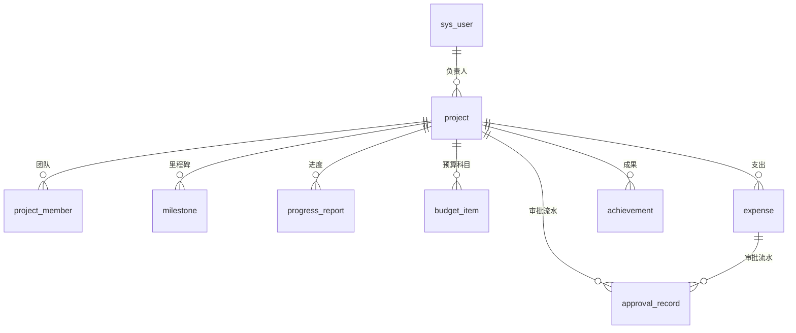

# 设计说明

本文档说明 RIMS 的设计决策与实现原理，覆盖范围取舍、状态机、数据模型、权限模型、并发控制、测试策略与安全设计。接口用法与部署步骤见 [README.md](README.md)。

---

## 1. 设计目标与范围

RIMS 的定位是科研院所的科研项目管理系统，核心诉求有三：

1. **主链路必须贯通** —— 从申报到结题验收是一条有审批、有回退、有留痕的链路，而不是若干互不相通的 CRUD 列表。因此项目状态被抽为独立的状态机，而非散落在各接口中。
2. **数据必须可信** —— 权限不可越界、预算不可超支、并发下不可丢更新。科研管理场景中，权限与经费一旦出错，代价远高于功能缺失。
3. **交付必须可运行、可验证** —— 采用单 jar 交付形态，并提供可复跑的自动化测试，使接收方能够自行验证而非依赖口头说明。

---

## 2. 范围决策

### 2.1 实现的模块

| 模块 | 实现深度 | 选择理由 |
| --- | --- | --- |
| 项目申报与两级审批 | 完整状态机 + 驳回重提 + 全量审批留痕 | 全生命周期管理的主干，缺失即不成立 |
| 权限体系 | 5 类角色，接口级 + 数据级（本人 / 本部门 / 全院） | 科研系统天然多角色，数据越权比功能缺失更严重 |
| 进度管理 | 里程碑 + 周期填报（进度 / 问题 / 下期计划） | 支撑「实时掌握项目进展」的最小组件集 |
| 经费管理 | 科目预算 + 支出申请 + 财务审批 + 原子额度占用 | 经费是科研管理风险最高的部分，规则必须由数据库层面强制 |
| 成果管理 | 5 类成果登记 + 结题前置校验 | 成果是验收依据，与状态机强关联 |
| 工作台 | KPI + 状态分布 + 经费执行 + 近 6 月支出 + 风险预警 | 管理者视角的统一入口，回答「待办」与「风险」 |
| 审计日志 | 关键动作落库（主体 / 动作 / 对象 / 时间） | 审批类系统缺少留痕则无法追责，实现成本极低 |

### 2.2 明确不实现的模块

| 不实现 | 原因 |
| --- | --- |
| 工作流引擎（Flowable / Activiti） | 本系统只有一条主流程与两级审批，引入引擎会显著提高流程可读性的维护成本，而状态机加审批记录表已足以表达，且更易测试。若后续出现多套申报模板或动态审批链，再引入不迟。 |
| 附件上传与合同扫描件 | 涉及文件存储、病毒扫描、权限继承，成本高而对主链路验证增益有限，列为演进项。 |
| 消息通知（邮件 / 站内信） | 通知属「触达」问题而非「流程」问题，MVP 以工作台待办与预警列表替代。 |
| 专家评审打分 / 会议评审 | 属评审子域，规则因院所而异，固化一套通用实现容易失真。 |
| 多租户与 SSO | 单院所部署，过早引入租户维度会使所有查询附加冗余条件。 |
| 自研前端组件库 | Element Plus 已覆盖中后台场景，自研只会拖慢交付节奏。 |

---

## 3. 角色与权限模型

### 3.1 角色定义

| 角色 | 代码 | 核心职责 |
| --- | --- | --- |
| 科研人员 | `RESEARCHER` | 申报、执行、报销、结题 |
| 部门管理员 | `DEPT_ADMIN` | 本部门项目初审 |
| 科研处管理员 | `ADMIN` | 立项、验收、预算调整、终止、全局数据 |
| 财务 | `FINANCE` | 经费审批 |
| 院领导 | `LEADER` | 全院只读看板与预警 |

### 3.2 权限矩阵

| 动作 | 科研人员 | 部门管理员 | 科研处 | 财务 | 院领导 |
| --- | --- | --- | --- | --- | --- |
| 新建 / 编辑草稿 | 本人 | ✓ | ✓ | ✗ | ✗ |
| 提交申报 | 负责人 | 本人项目 | ✓ | ✗ | ✗ |
| 部门审核 | ✗ | 本部门 | ✓（可代审） | ✗ | ✗ |
| 立项审批 | ✗ | ✗ | ✓ | ✗ | ✗ |
| 进度 / 成果 / 经费申请 | 项目组成员 | ✓ | ✓ | ✗ | ✗ |
| 经费审批 | ✗ | ✗ | ✓ | ✓ | ✗ |
| 结题验收 / 项目终止 | ✗ | ✗ | ✓ | ✗ | ✗ |
| 审计日志查询 | ✗ | ✗ | ✓ | ✗ | ✗ |

### 3.3 实现方式

权限分三个层次落地，各自解决不同问题：

- **接口级**：自定义 `@RequireRole` 注解配合 `AuthInterceptor` 统一拦截，角色要求声明在方法上，避免在每个方法体内重复编写判断。
- **数据级**：`ProjectService#applyScope` 统一构造可见范围条件——科研人员为「负责人 ∪ 项目组成员」，部门管理员为「本部门 ∪ 本人参与」，其余角色不限制。项目列表、经费列表、看板统计共用同一套规则，杜绝「某个接口遗漏过滤」这类难以排查的越权。
- **动作级**：`requireView` / `requireOperate` / `requireEdit` 三个方法将权限判断收口在服务层，任何写操作先校验权限，再进入业务规则。

审批环节额外校验角色与部门归属，科研人员调用审批接口直接返回 403，冒烟测试对此有专门断言。

> **为何未引入 Spring Security**：MVP 只需「认证 + 角色门禁」，自研拦截器约百行、行为完全可控。代价是路径放行规则需自行保证，已在 `WebConfig` 中显式列出白名单（登录、字典、H2 控制台、静态资源等）。若后续接入 SSO/OAuth2 或需要方法级细粒度权限，将替换为 Spring Security。

---

## 4. 状态机设计



设计要点：

- **状态仅在一处修改**：`WorkflowService` 是唯一入口，`ProjectService` 只维护数据、不触碰状态，保证「谁可以从哪个状态走到哪个状态」只有一份真相。
- **每次迁移必留痕**：`approval_record` 记录 `from_status / to_status / operator / opinion`，前端直接渲染为时间线，无需二次拼装。
- **前置条件内置于迁移入口**：提交时校验摘要字数、预期成果、预算总额；申请结题时校验成果数量与在途单据。校验失败返回可直接展示的中文提示，而非笼统的「操作失败」。
- **驳回可回退**：`REJECTED` 状态下允许编辑并重新提交，符合「申报被退回补充材料」的常态场景。
- **终态不可逆**：`COMPLETED` 与 `TERMINATED` 为终态，相关写操作在服务层直接拒绝。

---

## 5. 数据模型



| 表 | 作用 | 关键设计 |
| --- | --- | --- |
| `sys_user` | 用户与角色 | 角色以枚举字符串存储而非关联表：角色固定 5 类，关联表只会带来额外 join |
| `project` | 项目主档 | 逻辑删除 `deleted`；冗余 `leader_name / dept` 避免列表页关联查询；`version` 字段承载乐观锁 |
| `project_member` | 团队成员 | 负责人同样写入一条记录，便于统一查询「我参与的项目」 |
| `milestone` | 里程碑 | 状态仅 `PENDING / DONE`；**逾期不落库**，由 `plan_date` 与当前日期实时判定，避免引入定时任务 |
| `progress_report` | 进度填报 | 追加而非覆盖，保留历史；最新一条即为当前进度 |
| `budget_item` | 科目预算 | 5 个固定科目，合计须等于 `project.budget_total`；`reserved_amount` 记录已占用额度 |
| `expense` | 支出单据 | 状态 `PENDING / APPROVED / REJECTED`；冗余审批人与意见，列表可直接展示；`version` 字段承载乐观锁 |
| `achievement` | 成果 | 类型枚举；结题时按项目计数 |
| `approval_record` | 审批流水 | `biz_type + biz_id` 复用同一张表，支持项目与经费两类单据 |
| `audit_log` | 操作审计 | 记录全部关键动作（含创建、修改、登录）；与审批流水的区别在于此表覆盖非迁移类操作 |

**金额统一使用 `DECIMAL(14,2)`**：经费需精确到分，浮点累加会产生分位误差，在财务场景中属于不可接受的缺陷。

**里程碑逾期不落库**：逾期是「计划日期」与「今天」的函数，而非状态字段。若将逾期写入库，需要定时任务持续维护，且引入「何时标记」的边界歧义；实时判定始终给出与当前日期一致的结果。

---

## 6. 业务规则与事务边界

| 规则 | 实现位置 | 说明 |
| --- | --- | --- |
| 预算科目合计 = 预算总额 | `ProjectService#replaceBudgets` | 存在容差校验，超出即报错并提示差额 |
| 科目预算不得低于已占用额度 | `FinanceService#saveBudgets` | 防止下调预算击穿已发生的占用 |
| 支出申请额度校验 | `FinanceService#createExpense` | 原子占用：仅当「已占用 + 本次 ≤ 科目额度」时成功 |
| 审批时二次校验 | `FinanceService#approveExpense` | 防止「申请时未超、审批时额度已被其他单据占满」 |
| 驳回释放占用 | `FinanceService#approveExpense` | 释放仅在状态更新成功后执行，异常时事务整体回滚 |
| 结题前置条件 | `WorkflowService#submitAcceptance` | 至少 1 项成果，且无待审批单据 |
| 驳回必填意见 | `WorkflowService#review` | 无意见的驳回对申请人没有信息量 |
| 部门管理员限本部门 | `WorkflowService#review` | 跨部门审核直接 403 |
| 项目编号生成 | `ProjectService#nextCode` | `PRJ-{年}-{三位序号}`，插入前查重并递增 |

**事务边界**：涉及多表写入的操作（项目 + 成员 + 预算、审批 + 释放额度 + 流水记录）统一标注 `@Transactional`，避免产生「项目已建、预算未写入」这类半成品数据。经费驳回时若额度释放失败，异常向上抛出并回滚整个事务，单据状态与额度占用保持一致。

---

## 7. 并发控制与数据一致性

本系统在关键写入路径上避免应用层的「先查后写」，改由数据库保证正确性。

### 7.1 乐观锁：状态流转与单据审批

`project` 与 `expense` 表均带 `version` 字段，实体标注 `@Version`，并注册 MyBatis-Plus 的 `OptimisticLockerInnerInterceptor`。更新语句自动附加 `WHERE version = ?` 条件并自增版本号。

由于乐观锁插件在版本不匹配时不会抛出异常，而是让更新命中 0 行，因此服务层在更新后**必须校验受影响行数**：命中 0 行说明数据已被他人修改，此时抛出 409 冲突异常，提示用户刷新后重试，避免静默丢更新。

```java
int rows = expenseMapper.updateById(expense);
if (rows == 0) {
    throw BizException.conflict("该单据已被他人审批，请刷新后查看最新状态");
}
```

该机制消除的典型缺陷：两个并发审批请求同时读取到 `PENDING` 状态，若无版本校验，双方都会判定「单据待处理」并各自写入审批记录，产生重复审批流水。

### 7.2 原子占用：预算额度控制

原实现采用「查询已占用金额 → 判断是否超限 → 写入占用」的读改写流程，在并发场景下存在时间窗：两个请求可能同时通过校验并各自写入，导致最终占用超出科目额度。

改进方案是在 `budget_item` 上增加 `reserved_amount` 字段（语义为「审批中 + 已通过」的占用合计），占用与释放均为带条件的单条 UPDATE：

```sql
-- 占用：仅当占用后不超过科目额度时成功
UPDATE budget_item SET reserved_amount = reserved_amount + ? 
WHERE id = ? AND reserved_amount + ? <= amount;

-- 释放：仅当现有占用足够扣减时成功
UPDATE budget_item SET reserved_amount = reserved_amount - ? 
WHERE id = ? AND reserved_amount >= ?;
```

单条 UPDATE 语句在数据库层持有该行的排他锁，并发请求天然串行化，判定与写入成为原子操作，超支不再可能发生。占用失败时返回剩余额度与本次申请额，便于申请人调整。

配套约定：

- 申请支出时即占用额度，审批通过不改变占用（通过状态仍占用资金）；
- 审批驳回时释放额度；
- 调整科目预算时保留已有占用，且不允许将预算下调至已占用金额以下；
- 释放操作失败（占用数据异常）时抛出冲突异常并回滚事务，避免出现「单据已驳回但额度未释放」的不一致状态。

### 7.3 版本字段的初始化

乐观锁要求 `version` 非空：若插入时为 `NULL`，首次更新的 `WHERE version = NULL` 恒不成立，会被误判为并发冲突。因此项目与经费在创建时均显式设置 `version = 0`，避免依赖数据库默认值或 ORM 字段策略。

### 7.4 旧库升级：结构迁移

建表脚本使用 `CREATE TABLE IF NOT EXISTS`，因此对已存在的旧版本数据库不会变更结构。为避免升级后缺少新增列而导致运行期报错，应用启动时会执行一次结构迁移：

1. 通过 JDBC 元数据检测 `project.version`、`expense.version`、`budget_item.reserved_amount` 是否存在；
2. 缺失则执行 `ALTER TABLE ... ADD COLUMN`，并对存量行初始化为 `0`；
3. 新增 `reserved_amount` 时，按「已通过 + 审批中」回填各科目的占用额度，与业务侧的占用口径保持一致。

迁移在数据初始化之前执行（结构迁移为 `ApplicationRunner`，数据初始化为 `CommandLineRunner`），保证后续写入语句面对的始终是最新结构。该机制使交付版本可以在不重建数据库、不手工执行 DDL 的前提下直接接管既有环境。

---

## 8. 测试策略与质量保障

系统提供三层验证，覆盖面与运行成本依次递增。

### 8.1 后端集成测试

位于 `backend/src/test`，采用 `@SpringBootTest` + `@AutoConfigureMockMvc` 启动完整 Spring 上下文（拦截器、服务层、Mapper、内存 H2），以真实 HTTP 请求驱动业务，而非直接调用方法绕过校验链。3 个测试类共 7 个用例：

| 测试类 | 验证点 |
| --- | --- |
| `AuthAndAccessTest` | 未登录访问被拦截（401）、错误密码被拒（401）、正确登录签发令牌 |
| `WorkflowStateMachineTest` | 研究人员越权审批被拒（403）、对终态项目提交被拒（400）、正常推进至执行中且状态正确 |
| `FinanceBudgetTest` | 额度占用生效、超限申请被拒且占用未变、审批通过占用不变、驳回后占用回退 |

测试库使用内存 H2（`jdbc:h2:mem:`），与开发用文件库隔离，可重复运行。

> **测试断言的编码无关性**：运行环境 `file.encoding` 可能为 GBK，若断言直接比较中文字面量将出现不可预期的失败。因此涉及中文提示的断言改用消息中的 ASCII 标记（如金额数字）验证语义，确保测试在任何编码环境下结果一致。

### 8.2 端到端冒烟测试

`scripts/smoke-test.mjs` 基于 Node 内置 `fetch`，无额外依赖。覆盖 7 个环节共 26 项断言：

1. 登录与令牌签发
2. 工作台数据
3. 数据权限（科研人员看不到他人项目）
4. 申报 → 部门审核 → 立项，含「重复审批被拒」「越权立项被拒」
5. 执行期：里程碑 / 进度 / 成果 / 经费申请
6. 结题验收
7. 审批留痕与审计日志，含「非管理员查审计日志被拒」

该脚本面向已启动的服务运行，验证的是完整链路与越权拦截，可由接收方随时复跑。

### 8.3 演示数据作为场景夹具

`DataInitializer` 在空库时初始化 7 个账号与 8 个项目，覆盖草稿、待部门审核、待科研处立项、执行中、待验收、已结题、已驳回、经费接近上限、项目逾期等场景，打开工作台即可看到完整的预警与统计，无需手工造数。初始化具备幂等性：库中已有数据时跳过写入，仅对预算占用做一次对账，保证历史库升级后额度数据自洽。

---

## 9. 安全设计

| 面向 | 措施 |
| --- | --- |
| 口令存储 | BCrypt 加盐哈希，不可逆存储 |
| 令牌 | JWT（HS256），密钥经 SHA-256 派生；生产环境经 `RIMS_JWT_SECRET` 注入，不落入配置文件 |
| 令牌时效 | 默认 12 小时，可配置 |
| 请求上下文 | 登录态存于 `ThreadLocal`，在请求完成后于 `afterCompletion` 清理，避免线程池复用导致身份串号 |
| 令牌校验 | 除签名外回查数据库确认账号状态有效，账号被停用后令牌立即失效 |
| 跨域策略 | 来源白名单由 `rims.cors.allowed-origins` 配置，默认仅放行本机 8080 / 5173；不采用「通配来源 + 携带凭证」的宽松组合 |
| SQL 注入 | 全部参数化查询，无字符串拼接 |
| 信息暴露 | 业务异常返回可读的中文提示；未处理异常统一返回「服务异常」并记录完整堆栈至服务端日志，不向客户端泄漏内部细节 |
| 审计 | 关键动作落库，含操作主体、动作、对象与时间，仅科研处管理员可查询 |

---

## 10. 技术选型依据

| 选择 | 备选 | 依据 |
| --- | --- | --- |
| Spring Boot + Java 17 | Spring Cloud 微服务 | 单体足以支撑 MVP。微服务会引入 N 个中间件依赖，与「一条命令可运行」的交付目标冲突。代码已按 controller / service / mapper / entity 分层，未来可按业务域拆分。 |
| MyBatis-Plus | JPA | 列表页存在大量条件拼接与分页，`LambdaQueryWrapper` 表达更直观；代价是复杂 SQL 需手写，当前场景无此需求。 |
| H2 文件库（默认） | MySQL / Docker Compose | 「接收方可直接运行」优先级最高。H2 文件模式同时满足持久化要求，并保留 MySQL profile，切换仅需调整配置与参数。 |
| JWT + 自研拦截器 | Spring Security | 见 3.3 节。 |
| Vue 3 + Element Plus | Vue 2 + Element UI | Vue 3 组合式 API 在项目详情这类多状态页面中更易组织。 |
| ECharts | 其他图表库 | 中后台图表场景覆盖完整，按需引入成本低。 |
| 单 jar 内嵌前端 | Nginx 分离部署 | 降低交付环境变量数量；开发时仍保留 Vite 热更新，两种模式并存。 |

---

## 11. 已知问题与演进方向

**当前明确未覆盖的部分**

1. **工作台指标为内存聚合**：当前按可见范围取出项目与支出后在内存计算。单院所规模（数百项目）无碍，数据量达万级时需改为 SQL 聚合或物化视图。
2. **附件缺失**：任务书、发票、结题报告无法上传，真实业务必需项。
3. **无主动通知**：审批流转至下一环节不会主动提醒，依赖用户查看工作台。
4. **审计日志无归档策略**：长期运行会持续膨胀，需引入分区或定期归档。
5. **前端包体积**：ECharts 全量引入导致首屏 chunk 偏大，生产环境应按需引入。
6. **并发控制边界**：乐观锁覆盖项目状态与经费单据；进度填报、成果登记等低频写入未加版本控制，并发覆盖的风险可接受。

**演进优先级**

1. 附件上传与结题材料打包。
2. 与财务系统对接（凭证导出、对账）。
3. 消息通知（站内信 + 邮件）。
4. 申报书与结题报告模板导出（Word / PDF）。
5. 数据权限细化到项目密级，支持涉密项目隔离。
