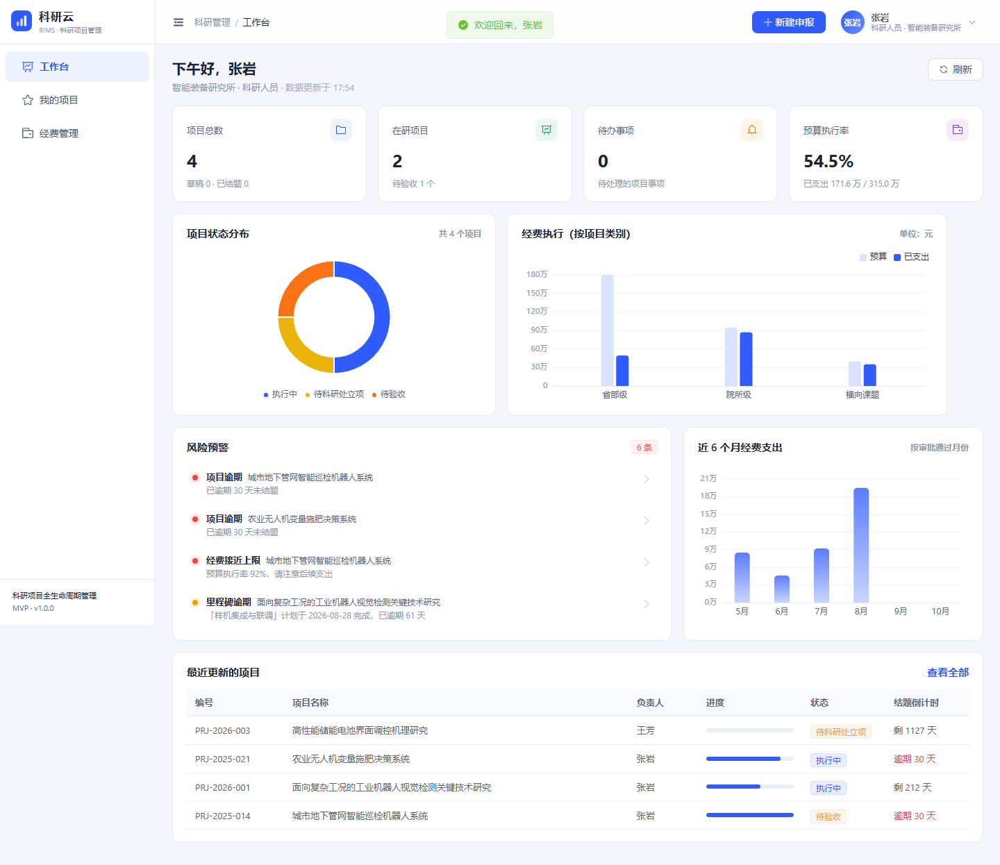

# 科研云 · 科研项目全生命周期管理系统（RIMS）

面向科研院所科研管理处的 MVP：从**项目申报 → 部门审核 → 科研处立项 → 进度/经费/成果管理 → 结题验收**全流程贯通，含角色权限、审批留痕、经费分科目管控与风险预警。

- 后端：Spring Boot 3.2 + Java 17 + MyBatis-Plus + JWT + H2（文件库，可切 MySQL 8）
- 前端：Vue 3 + Vite + Element Plus + Pinia + ECharts
- 交付形态：单 jar 同时提供接口与前端页面，`java -jar` 即可访问，无需装数据库



---

## 一、快速开始

### 环境要求

| 依赖 | 版本 | 说明 |
| --- | --- | --- |
| JDK | 17+ | 已用 Temurin 17.0.19 验证 |
| Maven | 3.8+ | 仅在源码构建时需要 |
| Node.js | 18+ | 仅在开发/重新构建前端时需要 |

### 方式 A：直接运行（推荐，单端口）

项目根目录已提供可执行 jar（内嵌前端静态资源与依赖），在**项目根目录**执行：

```bash
java -jar dist/rims-backend.jar
```

打开 <http://localhost:8080> 即可（接口与页面同端口）。首次启动会在运行目录下的 `data/` 创建 H2 文件库并写入演示数据。

> 若 `dist/` 下没有 jar，按"方式 C"重新打包即可。

### 方式 B：开发模式（前后端分离热更新）

```bash
# 终端 1：后端
cd backend
mvn spring-boot:run

# 终端 2：前端
cd frontend
npm install
npm run dev
```

前端运行在 <http://localhost:5173>，`/api` 已代理到 8080。

### 方式 C：从源码重新打包

```bash
cd frontend && npm install && npm run build      # 产物输出到 backend/src/main/resources/static
cd ../backend && mvn clean package -DskipTests   # 打出含前端的可执行 jar
cp target/rims-backend.jar ../dist/rims-backend.jar
java -jar ../dist/rims-backend.jar
```

### 数据与重置

- 数据默认落在**运行目录**下的 `data/rims.mv.db`（H2 文件模式，重启不丢）。
- 想恢复到初始演示数据：停止服务 → 删除 `data/` 目录 → 重启。
- 切换 MySQL 8：
  ```sql
  CREATE DATABASE rims DEFAULT CHARACTER SET utf8mb4;
  ```
  ```bash
  java -jar dist/rims-backend.jar --spring.profiles.active=mysql \
    --MYSQL_HOST=127.0.0.1 --MYSQL_USER=root --MYSQL_PASSWORD=你的密码
  ```
  建表脚本 `backend/src/main/resources/db/schema.sql` 同时兼容 H2(MySQL 模式) 与 MySQL 8。

---

## 二、演示账号

密码统一为 `123456`。

| 账号 | 姓名 | 角色 | 部门 | 能做什么 |
| --- | --- | --- | --- | --- |
| `zhangsan` | 张岩 | 科研人员 | 智能装备研究所 | 申报项目、填报进度、申请经费、登记成果、申请结题 |
| `zhaomin` | 赵敏 | 部门管理员 | 智能装备研究所 | 审核本部门申报 |
| `admin` | 陈立 | 科研处管理员 | 科研管理处 | 立项审批、结题验收、调整预算、终止项目、看全院数据、审计日志 |
| `zhouying` | 周颖 | 财务 | 财务处 | 审批经费支出 |
| `sunhao` | 孙皓 | 院领导 | 院办 | 全院只读看板 |
| `lisi` / `wangfang` | 李思远 / 王芳 | 科研人员 | 信息技术 / 新材料研究所 | 同科研人员 |

**建议体验路径**：用 `zhangsan` 登录 → 工作台看预警 → 我的项目 → 打开「面向复杂工况的工业机器人视觉检测…」→ 点「AI 预审」→ 切到 `admin` 看审批中心与审计日志。

---

## 三、已实现的功能

**项目管理**
- 申报草稿（基本信息、研究内容、团队成员、预算科目编制）
- 两级审批：部门审核 → 科研处立项；驳回需填写理由，可修改后重新提交
- 状态机：草稿 / 待部门审核 / 待科研处立项 / 执行中 / 待验收 / 已结题 / 已驳回 / 已终止
- 审批流水全记录（谁、何时、什么意见）

**执行管理**
- 里程碑：计划/实际完成日期，逾期自动进入预警
- 进度填报：百分比 + 本期工作 + 问题 + 下期计划，形成时间线
- 成果登记：论文/专利/软著/标准/研究报告，结题前必须有成果
- 经费：五大科目预算 + 支出申请 + 财务审批；**分科目额度双重校验**（申请时校验一次，审批时再校验一次）

**管理与洞察**
- 工作台：项目总数/在研/待办/预算执行率、状态分布、经费执行、近 6 个月支出、风险预警
- 审批中心：按角色聚合待审核项目、待立项、待验收、待审批经费
- 审计日志：关键动作留痕（管理员可查）
- AI 申报预审：形式审查打分 + 风险项 + 修改建议（见下文）

**权限**
- 接口级：`@RequireRole` + 拦截器统一校验
- 数据级：科研人员只看自己负责/参与的项目；部门管理员看本部门；科研处/财务/院领导看全院
- 关键动作二次校验：非负责人不能提交、不能审批自己的项目、部门管理员不能执行科研处立项

---

## 四、AI 预审是怎么做的

`POST /api/projects/{id}/ai-review`

- **默认：本地规则引擎**，零依赖、可离线、结果可复现。检查摘要完整度、预期成果、预算结构（劳务/设备占比）、周期合理性、团队规模等，输出 0-100 分与分级风险项。
- **可选：接入大模型**。配置后额外调用 OpenAI 兼容接口生成评审意见正文，评分仍由规则给出：

```bash
java -jar target/rims-backend.jar \
  --rims.ai.enabled=true \
  --rims.ai.api-key=sk-xxx \
  --rims.ai.base-url=https://api.deepseek.com/v1 \
  --rims.ai.model=deepseek-chat
```

响应中的 `engine` 字段会如实标注 `RULE` / `RULE+LLM` / `RULE(LLM调用失败，已降级)`，不把规则包装成大模型。

---

## 五、接口与调试

- Swagger UI：<http://localhost:8080/swagger-ui.html>
- H2 控制台：<http://localhost:8080/h2-console>（JDBC URL `jdbc:h2:file:./data/rims`，用户 `sa`，密码空）
- 统一响应：`{ "code": 0, "message": "ok", "data": ... }`，`code != 0` 即业务失败
- 鉴权：登录后带 `Authorization: Bearer <token>`

**端到端冒烟测试**（会真实走完申报→审批→执行→结题，并验证越权拦截）：

```bash
node scripts/smoke-test.mjs            # 默认 http://localhost:8080/api
```

期望输出 `27 通过 / 0 失败`。

---

## 六、目录结构

```
rims/
├─ backend/                     Spring Boot 后端
│  ├─ src/main/java/com/rims/
│  │  ├─ controller/            接口层
│  │  ├─ service/               业务层（WorkflowService 为状态机）
│  │  ├─ mapper/                MyBatis-Plus Mapper
│  │  ├─ entity/                表实体
│  │  ├─ dto/                   请求/响应对象
│  │  ├─ security/              JWT、拦截器、上下文
│  │  ├─ config/                Web 配置、演示数据初始化
│  │  └─ common/                统一响应、异常、字典
│  ├─ src/main/resources/
│  │  ├─ db/schema.sql          建表脚本（H2/MySQL 通用）
│  │  ├─ static/                前端构建产物（勿手改）
│  │  └─ application*.yml       默认 H2 / MySQL 两套配置
│  └─ data/                     H2 数据文件（运行时生成，已 gitignore）
├─ frontend/                    Vue 3 前端
│  └─ src/{views,layout,api,stores,utils}
├─ scripts/smoke-test.mjs       E2E 冒烟测试
├─ docs/screenshots/            界面截图
├─ DESIGN.md                    设计决策说明（必读）
└─ README.md
```

---

## 七、已知限制

1. 附件上传、消息通知（邮件/站内信）、专家评审打分不在 MVP 范围。
2. 单院所单租户；未做多租户隔离。
3. 经费额度校验为"先查后写"，高并发下仍可能被击穿；生产需加唯一约束/乐观锁或数据库行锁。
4. H2 用于开箱演示，生产建议 MySQL 8，并为 `project(status, dept)`、`expense(project_id, status)` 等字段补索引。
5. 演示数据由 `DataInitializer` 生成，仅用于展示流程，不代表真实业务数据。

更完整的设计取舍见 [DESIGN.md](DESIGN.md)。
